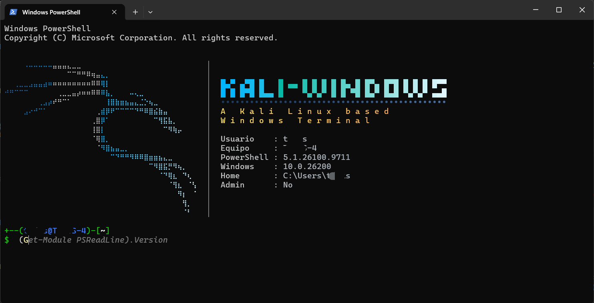
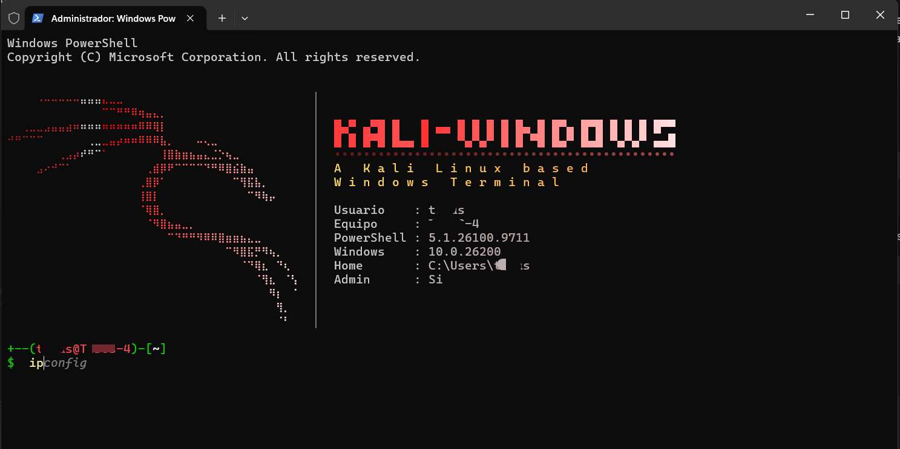

# Kali-Windows

> A Kali Linux styled banner and prompt for Windows PowerShell — no WSL, no dual boot, no Linux required.


---

## What is this?

**Kali-Windows** is a drop-in PowerShell profile that transforms the default Windows terminal into something that *feels* like Kali Linux:

- 🐉 **An ASCII dragon banner** rendered with a horizontal RGB gradient (blue → cyan → ice for normal sessions, red → coral → pale pink for elevated ones).
- 🖋️ **A Kali-style prompt** in two lines, with user, host, and abbreviated path (`~/projects` instead of `C:\Users\you\projects`).
- 🎨 **A "Kali-Windows" logo** built from block characters, with a `•` rule and a spaced tagline, all in the same palette.
- 📊 **Session info panel** at startup: user, host, PowerShell version, Windows build, home path, and admin status.
- ⚡ **Predictive autocompletion** powered by `PSReadLine` — start typing a command you have used before and the suggestion appears in gray. Press `→` to accept it.
- 🧠 **Smart `Tab`** — if a suggestion exists, `Tab` accepts it; otherwise it opens the classic completion menu.
- 🔴 **Elevated session awareness** — the entire banner and the prompt switch to red when you launch PowerShell as Administrator, so you *always* know when you have root-equivalent privileges.

Everything is contained in a single `.ps1` file. No external executables, no dependencies beyond what ships with Windows.

---

## Preview

<!-- Replace with real screenshots once the repo is public -->
| Normal session | Elevated session |
|:-:|:-:|
|  |  |

---

## Requirements

| Requirement | Minimum | Notes |
|---|---|---|
| **OS** | Windows 10 (1809+) or Windows 11 | Needs a terminal with ANSI/VT support. Windows Terminal, Windows Console Host, and VS Code's integrated terminal all qualify. |
| **Shell** | **Windows PowerShell 5.1** or **PowerShell 7+** | 5.1 ships with Windows 10/11. PowerShell 7 is recommended for the smoothest experience. |
| **`PSReadLine` module** | **2.1.0 or newer** | Windows PowerShell 5.1 ships with an outdated 2.0.0 that lacks predictive suggestions. PowerShell 7 ships with a recent version and needs no upgrade. |
| **Font** | A Nerd Font or any font with Braille (U+2800–U+28FF) and block (U+2580–U+259F) glyphs | Windows Terminal with **Cascadia Code** or **Cascadia Mono** works out of the box. |

> **Why PowerShell 5.1 as the floor?** The script uses `[pscustomobject]`, `[string]::new()`, and `[System.Text.UTF8Encoding]::new()` — all available since PS 5.0 — but the autocompletion feature strictly requires `PSReadLine` 2.1+. Earlier versions of PowerShell cannot install a compatible `PSReadLine`, so 5.1 is the practical minimum.

---

## Installation

### 1. Clone the repository

```powershell
git clone https://github.com/<your-user>/Kali-Windows.git
cd Kali-Windows
```

### 2. (Windows PowerShell 5.1 only) Upgrade `PSReadLine`

If you are on PowerShell 7, **skip this step**. If you are on 5.1, run:

```powershell
Install-Module -Name PSReadLine -Scope CurrentUser -Force
```

The installation may prompt you to install the NuGet provider first — answer **Yes**. Verify the upgrade:

```powershell
(Get-Module PSReadLine -ListAvailable | Sort-Object Version -Descending | Select-Object -First 1).Version
```

You should see `2.1.0` or higher.

### 3. Allow local scripts to run (one-time)

PowerShell blocks all scripts by default. Allow local profile scripts for your user only:

```powershell
Set-ExecutionPolicy RemoteSigned -Scope CurrentUser
```

`RemoteSigned` lets your local `.ps1` files run, while scripts downloaded from the internet must be signed. This is the recommended safe setting.

### 4. Create your profile file (if it does not exist)

```powershell
if (!(Test-Path -Path $PROFILE)) { New-Item -ItemType File -Path $PROFILE -Force }
```

### 5. Copy the profile into place

The full profile lives in [`src/Kali-Windows-Profile.ps1`](src/Kali-Windows-Profile.ps1). Copy it over your `$PROFILE`:

```powershell
Copy-Item -Path ".\src\Kali-Windows-Profile.ps1" -Destination $PROFILE -Force
```

> **⚠️ Encoding matters.** The file contains Unicode characters (Braille patterns, block elements, `•`). It **must** be saved as **UTF-8 with BOM**. Otherwise Windows PowerShell 5.1 will render them as `█▄▀` mojibake. The file shipped in this repo already has the BOM; only worry about this if you edit it yourself.

### 6. Reload

Close and reopen PowerShell. You should see the banner and the Kali prompt.

To verify the profile loads without errors:

```powershell
& $PROFILE
```

### Keyboard shortcuts

| Key | Behavior |
|---|---|
| `→` (right arrow) | Accept the gray suggestion |
| `Tab` | Accept the gray suggestion if present; otherwise open the completion menu |
| `↑` / `↓` | Navigate command history |
| `Ctrl+R` | Reverse search history |

---

## Customization

The profile is a plain `.ps1` file — open it in any editor and tune it to taste. The most useful knobs:

### Change the color palette

Each palette is a list of RGB stops. The dragón uses `$artStops`, the logo `$iceStops`, the rule `$ruleStops`, the info panel `$infoStops`, and the tagline `$tagStops`:

```powershell
$artStops = @(
    @(0x1E, 0x5A, 0x9E),   # start  (deep blue)
    @(0x00, 0xB4, 0xFF),   # middle (cyan)
    @(0xE0, 0xF7, 0xFF)    # end    (icy white)
)
```

To use a different palette (for example, the "custom" palette from the [abc-logo-generator](https://github.com/...)) just swap the stops.

### Add or remove info rows

The session info block is a single array. Add a line and it appears automatically:

```powershell
[pscustomobject]@{ Text = "Uptime     : $uptime"; Stops = $infoStops }
```

Ideas: `IP`, `Free disk`, `Uptime`, `Date`, `Process count`. Keep it under ~8 rows or the panel will overflow the dragon.

### Change the ASCII art

`$artLines` and `$logoLines` are plain string arrays. Any monospace block is fair game — just make sure the file stays UTF-8 with BOM if your new art uses Unicode.

---

## Troubleshooting

### I see `█▄▀` instead of `█▄▀`

The file was saved as UTF-8 **without** BOM. Windows PowerShell 5.1 interprets it as Windows-1252 and mangles every multi-byte character. Fix:

1. Open `$PROFILE` in VS Code or Notepad.
2. **File → Save As** and pick **UTF-8 with BOM**.
3. Restart PowerShell.

If you already saved it correctly but still see mojibake, run this to re-encode in-place:

```powershell
$content = Get-Content -Path $PROFILE -Encoding UTF8 -Raw
[System.IO.File]::WriteAllText($PROFILE, $content, (New-Object System.Text.UTF8Encoding($true)))
```

### `Set-PSReadLineOption : No parameter matches 'PredictionSource'`

Your `PSReadLine` is too old. Re-run step 2 of the installation:

```powershell
Install-Module -Name PSReadLine -Scope CurrentUser -Force
```

Then close and reopen PowerShell.

### The prompt is still `PS C:\Users\you>` (no banner)

The profile is failing to load. Ask PowerShell to read it and show the exact error:

```powershell
& $PROFILE
```

The most common causes are the encoding issue above, or an execution policy that reverted. Re-check `Set-ExecutionPolicy RemoteSigned -Scope CurrentUser`.

### Colors look washed out

Some terminal themes flatten RGB gradients. In **Windows Terminal**, set `"colorScheme": "One Half Dark"` (or any scheme with a dark background) and make sure `"useAcrylic": false` — acrylic backgrounds dull ANSI colors.

---

## How it works (briefly)

The profile is composed of four blocks:

1. **`PSReadLine` setup** — enables predictive suggestions and binds `Tab` to a script that *first* tries `AcceptSuggestion()`, and only if nothing changes falls back to `MenuComplete()`.
2. **ANSI enablement** — a tiny `Add-Type` P/Invoke that turns on `ENABLE_VIRTUAL_TERMINAL_PROCESSING` for Windows Console Host, which older consoles do not enable by default.
3. **Gradient renderer** — `Colorize-Line` walks every character of a line and computes its color from a multi-stop RGB palette based on its *absolute* column. That is why the dragon’s head and tail share one continuous gradient instead of restarting on every row.
4. **Composite banner + prompt** — the dragon is rendered on the left, a `│` separator in the middle, and the info panel is centered vertically on the right. The prompt re-checks admin status on every call so red/blue is always accurate.

---

## Contributing

PRs are welcome — especially new palettes, alternative ASCII art, and fixes for terminals that render the banner poorly. Please test your changes on both **Windows PowerShell 5.1** and **PowerShell 7** before opening a PR, and keep the `.ps1` saved as UTF-8 with BOM.

---

## License

Apache 2.0 — do whatever you want, attribution is nice but not required. See [LICENSE](LICENSE).

---

## Acknowledgements

- The color palette and "ice" gradient were tuned with [abc-logo-generator](https://github.com/...) — thanks for the inspiration.
- The ASCII dragon was drawn by hand and rendered with Braille patterns.
- Inspired, of course, by [Kali Linux](https://www.kali.org/) and the entire offensive security community.
```
